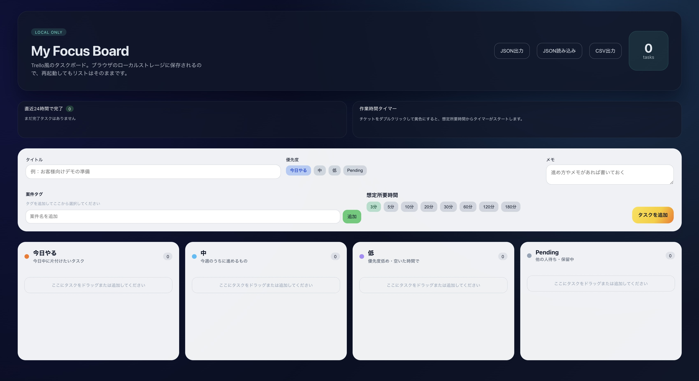

# ローカルタスクボード

日々のタスクを優先度別に整理するシンプルな React アプリです。カンバン形式で「今日やる / 中 / 低 / Pending」の4列にタスクを配置し、ドラッグ＆ドロップやローカルストレージ保存、プロジェクト名の管理などを行えます。

## スクリーンショット



## フロントエンド概要

- カンバン形式でタスクを「今日やる / 中 / 低 / Pending」に整理。
- プロジェクト名の追加・削除、タスクの詳細や想定作業時間を入力可能。
- 案件タグをドラッグ＆ドロップで並べ替え可能。
- 案件タグをダブルクリックして名称を編集可能。既存タスクのタグ名にも反映。
- 優先度タグと各カンバン列の説明文をダブルクリックして編集可能。
- ローカルストレージに自動保存されるためブラウザを閉じても状態を保持。
- ドラッグ＆ドロップで優先度列の移動に対応。
- ダブルクリックで1件のみタスクを黄色ハイライト（作業中ステータス）。
- Cmd/Ctrl + Z で直前の操作を取り消す Undo ショートカットに対応。
- CSV/JSON でタスクと案件タグの状態をエクスポート/インポート可能。

## セットアップ

```bash
git clone <this-repo>
cd my-dashboard-app
npm install
```

## 開発サーバー

```bash
npm start
```

ブラウザで [http://localhost:3000](http://localhost:3000) を開くとアプリが表示されます。ファイルを更新すると自動でリロードされます。

## テスト

```bash
npm test
```

watch モードでテストが実行されます。必要に応じて `a` や `p` などのショートカットを利用してください。

## 本番ビルド

```bash
npm run build
```

`build/` 配下に最適化された静的ファイルが生成されます。任意のホスティングサービスにデプロイしてください。

## デプロイのヒント

- React フロントは静的ホスティング（Vercel、Netlify など）で十分。
- PWA 化やバックエンド連携など、必要に応じて機能拡張してください。
